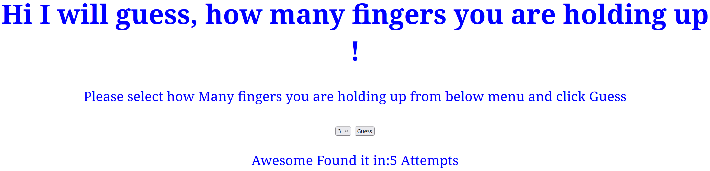

# Number of Fingers

A simple browser-based guessing game where the computer tries to guess how many fingers you're holding up.

## Features

- Select a number between 1 and 5.

- Computer generates random guesses.

- Automatically guesses until it finds the correct number.

- Displays the number of attempts taken.

## Screenshots



## Live Demo : [Play Number of Fingers](http://amalk.au/guess-game/)

## Tech Stack

- HTML5

- CSS3

- Vanilla JavaScript

## Getting Started

Clone the repository:

```
git clone https://github.com/amalk-au/guess-game.git
cd guess-game
```

Open `index.html` in your browser.

Alternatively, start a local server:

```
python3 -m http.server 8000
```

Visit `http://localhost:8000`.

## Project Structure

```
guess-game/
├── index.html
├── LICENSE
└── README.md
```

## How to Play

1.  Select the number of fingers you're holding up (1–5).

2.  Click **Guess**.

3.  Let the computer guess your number.

4.  See how many attempts it takes!

## Deployment

Hosted using GitHub Pages. No build process or additional dependencies required.

## License

This project is licensed under the [MIT License](LICENSE).

## Contact

**Amal K.**

- GitHub: [@amalk-au](https://github.com/amalk-au)

- Repository: [guess-game](https://github.com/amalk-au/guess-game)
